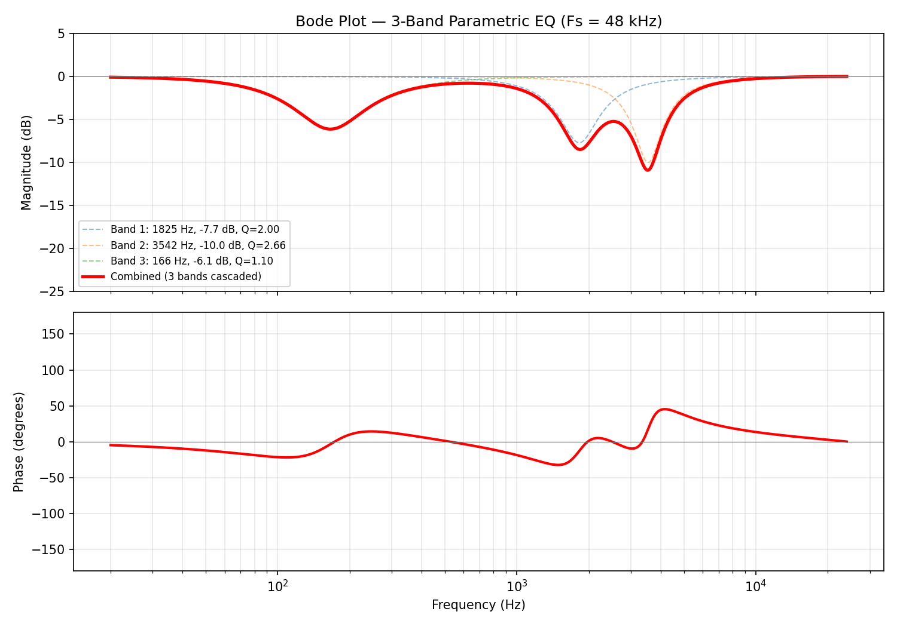

# 3-Band Parametric EQ on Speaker Output

## Overview

A 3-band parametric equalizer has been added to the Satellite1 speaker output path. The EQ processes audio immediately before it is sent to the DAC via I2S, shaping the frequency response of the speaker output. The AEC reference signal is derived downstream of the EQ, so it accurately models what the speaker produces.

## Signal Path

```
Audio Source (USB or I2S)
        │
        ▼
  speaker_pipeline_input()
        │
        ▼
  speaker_pipeline_output()
        │
        ├── Pack into interleaved tmp buffer
        │
        ├── *** 3-Band Parametric EQ (new) ***
        │
        ├── rtos_i2s_tx_1() → DAC → Speaker
        │
        └── Downsample 48kHz → 16kHz → AEC reference queue
```

The EQ applies to all audio reaching the speaker, regardless of source.

## EQ Band Definitions

All bands are **peaking EQ** filters (Robert Bristow-Johnson Audio EQ Cookbook).

| Band | Frequency (Hz) | Gain (dB) | Q    | Purpose |
|------|-----------------|-----------|------|---------|
| 1    | 1825            | -7.7      | 2.00 | Mid cut |
| 2    | 3542            | -10.0     | 2.66 | Upper-mid cut |
| 3    | 166             | -6.1      | 1.10 | Low-frequency cut |

## Frequency Response



The combined response shows three distinct notches at the target frequencies. Bands 1 and 2 overlap in the 1–4 kHz region, creating a broad cut reaching approximately -12 dB. The phase response remains well-behaved with no abrupt discontinuities.

The plot shows the designed electrical filter response, not a measurement of
the loudspeaker. PR #105 did not include the raw acoustic measurements or the
measurement setup used to choose the three bands. To validate the tuning,
measure the same unit with and without EQ and record the enclosure, microphone
position and distance, playback level, and test environment.

## Implementation Details

**Sample rate:** 48,000 Hz (enforced at compile time against the DAC I2S configuration)
**Sample format:** int32_t, 24-bit left-justified
**Frame size:** 720 samples per channel (240 × 3 SR factor)
**Channels:** 2 (L/R stereo, processed independently)

### Fixed-Point Arithmetic

- Coefficients stored in **Q28** format (1 sign bit, 3 integer bits, 28 fractional bits)
- Q28 chosen because the largest coefficient magnitudes reach ~2.0, well within the [-8, +8) range
- Multiply-accumulate uses `int64_t`. For this table, each coefficient magnitude is below 2^29, so the sum of five products with int32_t samples fits in int64_t.
- Each section shifts the accumulator right by 28 and saturates to int32_t before storing the result in its feedback history. Cuts can still overshoot on transients.

### Filter Structure

Direct Form I biquad, 3 sections cascaded per channel:

```
y[n] = b0·x[n] + b1·x[n-1] + b2·x[n-2] - a1·y[n-1] - a2·y[n-2]
```

Each biquad maintains 4 words of state (x1, x2, y1, y2). Total state: 3 bands × 2 channels × 4 words = 24 int32_t values, allocated as `static` locals.

### Q28 Coefficients

Computed from the Audio EQ Cookbook peaking EQ formulas at Fs = 48000 Hz:

**Band 1** (1825 Hz, -7.7 dB, Q=2.00):
| Coeff | Float | Q28 |
|-------|-------|-----|
| b0 | 0.9503950317 | 255119724 |
| b1 | -1.7792416023 | -477611531 |
| b2 | 0.8808525989 | 236452069 |
| a1 | -1.7792416023 | -477611531 |
| a2 | 0.8312476305 | 223136337 |

**Band 2** (3542 Hz, -10.0 dB, Q=2.66):
| Coeff | Float | Q28 |
|-------|-------|-----|
| b0 | 0.9110778211 | 244565590 |
| b1 | -1.5562208438 | -417744852 |
| b2 | 0.8288291992 | 222487144 |
| a1 | -1.5562208438 | -417744852 |
| a2 | 0.7399070203 | 198617278 |

**Band 3** (166 Hz, -6.1 dB, Q=1.10):
| Coeff | Float | Q28 |
|-------|-------|-----|
| b0 | 0.9930185978 | 266561400 |
| b1 | -1.9718605991 | -529317299 |
| b2 | 0.9793076143 | 262880886 |
| a1 | -1.9718605991 | -529317299 |
| a2 | 0.9723262121 | 261006830 |

## Files Changed

### New: `satellite-xmos-firmware/src/eq/biquad_eq.h`

Header-only implementation containing:
- `biquad_state_t` — per-section filter state (4 × int32_t)
- `biquad_coeffs_t` — per-section coefficients (5 × int32_t)
- `biquad_eq_bands[]` — pre-computed Q28 coefficient table for all 3 bands
- `biquad_process_sample()` — inline Direct Form I biquad
- `biquad_eq_process_frame()` — applies 3 cascaded biquads to a channel buffer with configurable stride
- `biquad_eq_process_stereo()` — applies the filter to interleaved stereo, independent of the number of microphones

### Modified: `satellite-xmos-firmware/src/main.c`

- Added `#include "eq/biquad_eq.h"`
- Inserted EQ processing block in `speaker_pipeline_output()` between the sample packing loop and `rtos_i2s_tx_1()`:

```c
static biquad_state_t eq_state[BIQUAD_EQ_CHANNELS][BIQUAD_EQ_NUM_BANDS];
biquad_eq_process_stereo(tmp, eq_state, frame_count);
```

## Computational Cost

### Operations Per Frame

Per frame (720 stereo samples, every 15 ms):
- 720 samples × 2 channels × 3 bands = 4,320 biquad evaluations
- Each evaluation: 5 multiplies + 4 adds (int64_t) + 1 shift
- Approximately 21,600 multiply-accumulate operations per frame

### Hardware Timing (Pending)

The original PR's ~1.5 ms estimate was for the unsaturated implementation;
it is not a timing result or a guarantee of scheduling headroom.
On a Satellite1 running the production and four-mic variants, bracket
`biquad_eq_process_stereo()` with xCORE reference timer reads. Capture the
elapsed ticks after the timed region, for example via xSCOPE. Record the
median and maximum across sustained playback with AEC and normal control
traffic active. Include loud transitions that exercise clipping. Compare
against the 15 ms frame period and confirm the complete speaker pipeline
meets its deadline without underruns or audible glitches. Check that AEC
still converges during playback.

## Host Tests

Run `pytest tests/test_dsp_host/test_speaker_eq.py` with a host C compiler and
the dependencies in `requirements_tests_dsp.txt`. The tests compile and
exercise the firmware EQ directly: frequency response, impulse and step
response, full-scale clipping, stereo isolation, and continuity across frames.
